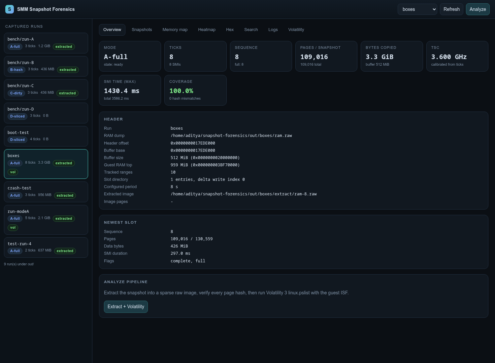
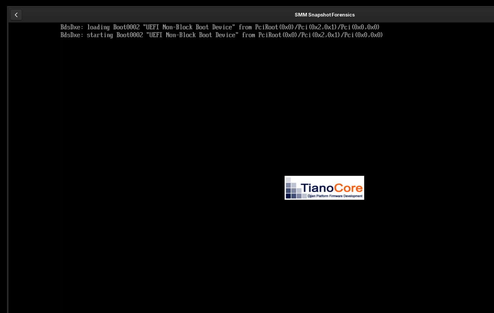

# SMM Snapshot Forensics

A working prototype of **periodic, firmware-level physical-memory snapshots** taken
from System Management Mode (SMM), independent of the operating system. It runs on
QEMU's Q35 machine with an EDK II/OVMF firmware build, a minimal Linux guest, and
includes extraction, hash verification, Volatility 3 validation, benchmarking, a
GNOME Boxes/libvirt path, and a local web GUI.



This is the implementation companion to the design paper *Below the Operating
System: Periodic Firmware-Level Memory Snapshots for Crash and Compromise
Forensics* (`paper.pdf`). It is a research prototype for QEMU, not a production
or hardware-ready tool.

Development history, decisions, and the log-file map are in
[`PROGRESS.md`](PROGRESS.md).

---

## What is actually working

- OVMF built with `-D SMM_REQUIRE=TRUE`, containing three new components:
  - `SnapshotDxe` (DXE): allocates a contiguous `EfiReservedMemoryType` buffer,
    builds the capture range list from `GetMemoryMap()`, and sends the
    configuration to SMM at `DxeSmmReadyToLock`.
  - `SmmSnapshotDriver` (`DXE_SMM_DRIVER`): registers a periodic-timer SMI
    handler and implements capture modes A/B/C/D entirely inside SMRAM.
  - `SmmPeriodicTimerDxe` (`DXE_SMM_DRIVER`): drives QEMU's ICH9 periodic SMI
    source and exposes `EFI_SMM_PERIODIC_TIMER_DISPATCH2_PROTOCOL`.
- Periodic snapshots every 8 seconds (hardware granularity of the ICH9 timer).
- A 512 MiB reserved ring buffer in a 1 GiB guest; a full snapshot covers about
  **109,016 pages (~426 MiB)**.
- A structured, self-describing header and slot directory inside the reserved
  buffer, with per-page FNV-1a hashes.
- Extraction into a sparse raw image with **0 hash mismatches** and **100%
  coverage** of the tracked pages.
- Volatility 3 `linux.pslist` resolves the live guest from the extracted image;
  PIDs match the guest's own serial log (`init`, `snapw0`–`snapw3`).
- The same firmware boots as a **GNOME Boxes / libvirt** domain with SMM enabled.
- A dependency-free local web GUI discovers every dump under `out/`, parses the
  header, and renders snapshots, memory maps, page maps, a heatmap, hex, search,
  logs, and Volatility output.

---

## Architecture

```
┌────────────────────────────── guest (Linux 6.12.58) ─────────────────────────────┐
│  init + snapw0..3 write to private pages; no snapshot code runs in the OS        │
└───────────────────────────────────┬──────────────────────────────────────────────┘
                                    │ ordinary physical memory
┌───────────────────────────────────▼──────────────────────────────────────────────┐
│ OVMF (SMM_REQUIRE)                                                               │
│                                                                                  │
│  SnapshotDxe (DXE)                                                               │
│    GetMemoryMap() → conventional + loader code/data ranges                       │
│    AllocatePages(EfiReservedMemoryType, contiguous, 512 MiB)                     │
│    DxeSmmReadyToLock notify → SMM Communication with SNAPSHOT_CONFIG             │
│                                                                                  │
│  SmmSnapshotDriver (SMRAM)                                                       │
│    validates config, allocates hash/seen/bitmap arrays, initializes header       │
│    EFI_SMM_PERIODIC_TIMER_DISPATCH2 handler → capture mode A/B/C/D               │
│                                                                                  │
│  SmmPeriodicTimerDxe (SMRAM)                                                     │
│    ICH9 GEN_PMCON_1 period select + SMI_EN.PERIODIC_EN                           │
└───────────────────────────────────┬──────────────────────────────────────────────┘
                                    │ reserved ring buffer
┌───────────────────────────────────▼──────────────────────────────────────────────┐
│ host: QEMU monitor `pmemsave` → ram.raw                                          │
│       scripts/extract_snapshot.py → sparse image + hash verification             │
│       Volatility 3 (linux.pslist) → processes                                   │
│       gui/server.py → browser UI                                                │
└──────────────────────────────────────────────────────────────────────────────────┘
```

### Why a periodic SMI producer is included

OVMF does not ship a periodic SMI source by default. QEMU's ICH9 LPC implements
one, but the firmware must enable it. `SmmPeriodicTimerDxe` programs
`GEN_PMCON_1` bits `[1:0]` (8/16/32/64 s), sets `SMI_EN` bit 14, clears
`SMI_STS` bit 14, and implements the PI dispatch protocol so
`SmmSnapshotDriver` can register a child handler. The producer only invokes its
children when `SMI_STS.PERIODIC_STS` is set, so unrelated SMIs do not trigger
snapshots.

### Capture modes

| Mode | Name | What each tick does | Cost / use |
|------|------|---------------------|------------|
| A | full | Copies every validated page into the full slot. | Simplest; one complete image per tick; ~300–1400 ms SMI in QEMU. |
| B | hash incremental | Hashes every page (FNV-1a over 4 KiB), copies only pages whose hash changed into a delta slot. | Lower copy volume; still reads all pages to hash. |
| C | dirty / page-table | Reads each CPU's `CR3` from the SMM save state, walks 4-level page tables (1 GiB/2 MiB/4 KiB), and copies present pages whose PTE dirty bit is set **and** whose hash changed. The OS dirty bit is never cleared. | Captures pages reachable from current address spaces; misses non-mapped dirty memory; depends on the OS setting A/D bits. |
| D | sliced full | Full capture spread across SMIs, `PcdSnapshotMaxPagesPerSmi` pages per tick with a persistent cursor. After one complete image it idles and keeps that image. | Bounds SMI stall time; a full image takes `ceil(pages / max_pages)` ticks. Use A/B/C for continuous snapshots. |

Modes B/C keep one base full slot plus a ring of delta slots
(`PcdSnapshotDeltaSlots`) and force a new full snapshot every
`PcdSnapshotFullEvery` snapshots. Mode A/D publish the full slot at directory
index 0.

### Buffer layout

All structures are packed little-endian and described in
`SnapshotPkg/Include/Snapshot.h`; `scripts/snapshot_format.py` mirrors them.

```
buffer_base
  +0x0000  SNAPSHOT_HEADER (0x1000 bytes, includes 32 slot-directory entries)
  +0x1000  SNAPSHOT_MEM_RANGE[RangeCount]
  ...      full slot:  SNAPSHOT_SLOT_HEADER (4 KiB reserved) | page map | page data
  ...      delta slots: slot header (120-byte struct) | page map | page data
```

Header fields include magic (`SNAPMMS1`), version, mode/state, buffer base/size,
slot-directory geometry, sequence numbers, tick/SMI counters, calibrated TSC
frequency, total/max/last SMI duration, page and byte counters, guest RAM top,
the memory-range table, and the configured period (stored in `Reserved[0]`).

Each page-map entry is `{physical address, 32-bit hash, flags}`; each slot header
records page count, capacity, data/page-map offsets, sequence, tick, TSC, and SMI
duration. The extractor verifies every page hash before writing it.

---

## Repository layout

```
SnapshotPkg/                 EDK II package (DXE + SMM drivers, ABI header)
scripts/setup_edk2.sh        clone/submodules, iasl, BaseTools, integrate, build OVMF
scripts/integrate_edk2.py    idempotent DSC/FDF patching (PCDs + components)
scripts/build_guest.sh       static init + Linux kernel + FAT32 ESP
scripts/run_qemu.sh          direct QEMU Q35 boot and RAM dump
scripts/boxes.sh             libvirt/GNOME Boxes define/start/capture/analyze
scripts/extract_snapshot.py  locate header, rebuild image, verify hashes
scripts/snapshot_format.py   Python mirror of the on-disk ABI
scripts/analyze.sh           extraction + Volatility (used by the GUI)
scripts/validate_volatility.sh  ISF generation + linux.pslist + serial cross-check
scripts/benchmark.sh         per-mode build/run/extract/validate loop
scripts/bench_report.py      benchmark table
scripts/start_gui.sh         one-command GUI launcher
gui/server.py                stdlib HTTP server + JSON API
gui/static/                  single-page frontend (vanilla JS/canvas)
guest/                       init.c, kernel config/build output, ESP image
edk2/                        EDK II checkout and OVMF build
out/                         dumps, extractions, analysis, benchmark results
```

---

## Prebuilt release artifacts

If you do not want to build EDK II and the guest, the
[v0.1.0 release](https://github.com/SyncodeX7/snapshot-forensics/releases/tag/v0.1.0)
contains the exact binaries and a sample capture used for the benchmark in this
README:

| Asset | Size | What it is |
|-------|------|------------|
| `OVMF_CODE.fd` | 3.5 MiB | OVMF built with `SMM_REQUIRE=TRUE`, mode A, 8 s period |
| `OVMF_VARS.fd` | 528 KiB | Matching variable-store template |
| `esp.img` | 64 MiB | FAT32 ESP with the minimal Linux guest |
| `linux-6.12.58.json` | 49 MiB | Volatility 3 ISF for the guest kernel |
| `ram-12-A.raw.zst` | 51 MiB | Complete mode-A snapshot, 109,016 pages, zstd-compressed |
| `snapshot-12-A.json` | 4 KiB | Extraction metadata for the sample (coverage, hashes) |
| `sample-pslist.txt` | 8 KiB | Expected `linux.pslist` output for the sample |
| `SHA256SUMS` | 569 B | Checksums for every asset |

Verify and run the prebuilt firmware:

```bash
sha256sum -c SHA256SUMS

scripts/run_qemu.sh \
  --code OVMF_CODE.fd --vars OVMF_VARS.fd --esp esp.img \
  --mem 1G --seconds 60
```

Analyze the sample image directly:

```bash
zstd -d ram-12-A.raw.zst
mkdir -p out/isf && cp linux-6.12.58.json out/isf/
tools/venv/bin/vol -s out/isf -f ram-12-A.raw linux.pslist
```

The sample should list `init` and `snapw0`–`snapw3`; compare with
`sample-pslist.txt`. To use the prebuilt firmware with GNOME Boxes, point the
domain's `<loader>` and `<nvram template>` at these two files (or replace the
built files under `edk2/Build/OvmfX64/DEBUG_GCC/FV/` after running
`scripts/setup_edk2.sh`).

---

## Build

Prerequisites used here: `gcc`, `nasm`, `python3`, `qemu-system-x86_64`, `mtools`
(`mkfs.vfat`, `mcopy`), `bison`/`flex`, `pahole`, `git`, and a Linux host with
`/dev/kvm`. `iasl` is built locally from ACPICA by the setup script, and a locally built
GNU `bc` is provided at `tools/bin/bc`, so no root/package installs are required.

### 1. Firmware

```bash
scripts/setup_edk2.sh --mode 0        # mode A by default
```

This clones EDK II, initializes the submodules OVMF needs, builds BaseTools and
`iasl`, wires `SnapshotPkg` into `OvmfPkg/OvmfPkgX64.dsc`/`.fdf`, and builds:

```
edk2/Build/OvmfX64/DEBUG_GCC/FV/OVMF_CODE.fd
edk2/Build/OvmfX64/DEBUG_GCC/FV/OVMF_VARS.fd
```

Equivalent manual build:

```bash
cd edk2
export WORKSPACE=$PWD
export PACKAGES_PATH=$PWD:/path/to/snapshot-forensics
export EDK_TOOLS_PATH=$PWD/BaseTools
export PATH=/path/to/snapshot-forensics/tools/acpica-R2025_04_04/generate/unix/bin:$PATH
source edksetup.sh BaseTools
build -a X64 -t GCC -p OvmfPkg/OvmfPkgX64.dsc -D SMM_REQUIRE=TRUE -b DEBUG
```

### 2. Guest

```bash
scripts/build_guest.sh
```

Builds `guest/init` (static), a Linux 6.12.58 kernel with DWARF4 debug info and a
built-in initramfs, and a 64 MiB FAT32 image `guest/esp.img` containing
`\EFI\BOOT\BOOTX64.EFI`. The kernel command line is built in
(`console=ttyS0 nokaslr`, no KASLR) so Volatility's ISF matches.

### 3. Volatility symbols

```bash
mkdir -p out/isf
tools/bin/dwarf2json linux --elf guest/kbuild/vmlinux > out/isf/linux-6.12.58.json
```

Volatility 3 is installed in `tools/venv`; `scripts/validate_volatility.sh`
generates the ISF automatically if it is missing.

---

## Run

### Direct QEMU

```bash
scripts/run_qemu.sh --seconds 60 --out out/run-modeA
python3 scripts/extract_snapshot.py out/run-modeA/ram.raw -o out/run-modeA/extract
scripts/validate_volatility.sh \
    --image out/run-modeA/extract/ram-*.raw \
    --serial out/run-modeA/serial.log
```

`run_qemu.sh` boots `q35,smm=on`, secure pflash OVMF, and the ESP as a virtio
disk. It waits for `SNAPSHOT-GUEST: booted`, runs for the requested time, then
uses the QEMU monitor to `pmemsave` the guest's RAM to `ram.raw`. The OVMF debug
port is captured in `ovmf_debug.log`; the guest console in `serial.log`.

### GNOME Boxes / libvirt

Boxes' default VMs do **not** enable SMM, and this OVMF will not boot without
it. `scripts/boxes.sh` defines a proper session domain (the connection Boxes
uses, `qemu+unix:///session`) with `q35`, `<smm state='on'/>`, and secure pflash.
The display is SPICE, not VNC: GNOME Boxes 50 only implements SPICE, and a VNC
domain fails with `unsupported display of type vnc`.

To register and boot it:

```bash
scripts/boxes.sh define          # register "snapshot-forensics"
scripts/boxes.sh start           # boot it
gnome-boxes                      # it appears in the Boxes UI
```



One-command capture + analysis:

```bash
scripts/boxes.sh run --seconds 30
```

This boots the domain, waits for the guest, dumps RAM to `out/boxes/ram.raw`
via the libvirt QEMU monitor, and runs extraction + Volatility. Other commands:

```bash
scripts/boxes.sh status
scripts/boxes.sh capture         # dump the running domain
scripts/boxes.sh analyze         # extract + Volatility for the newest dump
scripts/boxes.sh stop
scripts/boxes.sh list            # what Boxes sees on the session connection
```

The domain XML is generated at `out/boxes/domain.xml`; the serial log is
`out/boxes/serial.log`. Because Boxes has no "dump RAM" button, use
`boxes.sh capture` (or `run`) to produce the forensic image.

### Web GUI

```bash
scripts/start_gui.sh             # http://127.0.0.1:8787/
```

or:

```bash
python3 gui/server.py --port 8787
```

The server uses only the Python standard library. It walks `out/` for
`ram.raw`, locates and validates the snapshot header, and exposes:

| Tab | Contents |
|-----|----------|
| Overview | mode/state, ticks, sequences, pages, bytes, TSC, SMI durations, coverage, header fields |
| Snapshots | slot timeline chart and directory; click a slot for its page map |
| Memory map | tracked `EfiConventionalMemory` / loader ranges |
| Heatmap | captured pages across physical address space |
| Hex | physical-memory viewer (original dump or extracted image) |
| Search | ASCII search with context; click a hit to open hex |
| Logs | guest serial and OVMF debug-port tails |
| Volatility | `linux.pslist` output for the run |

The **Analyze** button runs `scripts/analyze.sh` in the background: extract,
verify every page hash, then `linux.pslist`. Tabs are deep-linkable, e.g.
`http://127.0.0.1:8787/#boxes?tab=heatmap`.

---

## Benchmark

```bash
scripts/benchmark.sh --modes A,B,C,D --seconds 100
```

The script rebuilds OVMF for each mode, boots the guest, dumps RAM, extracts and
verifies the snapshot, runs Volatility, and prints a comparison table. Mode D is
automatically given at least 170 s so that a sliced full snapshot can complete
(109,016 pages / 8,192 pages per SMI ≈ 14 ticks at 8 s). At the end it restores
the default mode-A OVMF build.

Measured on QEMU 11.1.1/KVM, Q35 + OVMF (DEBUG), 1 GiB guest, 512 MiB
reserved buffer, 8 s period, `linux.pslist` validation. Modes A/B/C ran 100 s
after boot (12 ticks); mode D ran 170 s so the sliced capture could finish.
`copied` is the header's cumulative bytes copied (it includes every full base
and every delta, so B/C include two full bases because a forced full happens at
tick 8).

| Run | Mode | Seq | Ticks | Slots | Pages | Captured | Copied | SMI total | SMI max | Overhead | Hash bad | Coverage |
|-----|------|-----|-------|-------|-------|----------|--------|-----------|---------|----------|----------|----------|
| extract-A | A-full | 12 | 12 | 1 | 109,016 | 425.8 MiB | 5,110 MiB | 1,203 ms | 294.2 ms | 1.253% | 0 | 100% |
| extract-B | B-hash | 12 | 12 | 5 | 109,016 | 425.8 MiB | 904 MiB | 244.6 ms | 97.9 ms | 0.255% | 0 | 100% |
| extract-C | C-dirty | 12 | 12 | 5 | 109,016 | 425.8 MiB | 904 MiB | 218.9 ms | 103.6 ms | 0.228% | 0 | 100% |
| extract-D | D-sliced | 1 | 21 | 1 | 109,016 | 425.8 MiB | 425.8 MiB | 188.6 ms | 24.3 ms | 0.112% | 0 | 100% |

All four modes produced images that Volatility resolved, including `init` and
`snapw0..snapw3`; every page hash matched.

Observations:

- Mode A copies a complete 426 MiB image every tick: 5.1 GiB over 12 ticks and
  a 294 ms worst-case SMI in this VM.
- Modes B/C write much less (about 904 MiB total including two full bases and
  the deltas) and their worst SMI is roughly 100 ms. B still reads and hashes
  every page each tick; C walks page tables and only considers dirty mappings.
- Mode D bounds the SMI at **24 ms** by copying 8,192 pages per tick. The full
  image took 14 capture ticks; the dump was taken at tick 21 after mode D had
  kept the completed image and idled.
- These are virtualized numbers. They show the relative shape of the design
  space, not bare-metal latency.


Interpretation notes:

- `smi_max_ms` is the worst observed SMI duration; `overhead_pct` is total SMI
  time divided by the wall-clock window covered by the periodic ticks.
- Mode A copies everything every tick; mode B/C copy far less but still read
  and hash every tracked page (B) or walk page tables (C).
- Mode D trades latency for bounded stall time: one full image is assembled
  across several SMIs, so it is the right mode when a single 8-second SMI must
  not monopolize the CPU. Because the ring has one full slot, mode D keeps the
  completed image and stops capturing instead of overwriting it mid-rebuild.
- QEMU/KVM timings are indicative, not hardware measurements.

---

## Validation details

- **Hash verification**: every page map entry stores a 32-bit folded FNV-1a hash.
  The extractor recomputes it for each copied page and reports mismatches.
- **Coverage**: unique captured pages divided by the header's tracked page count.
- **Volatility**: `linux.pslist` runs on the extracted image with an ISF built
  from the exact guest `vmlinux`. The guest prints its process IDs on the serial
  console; the same PIDs/names must appear in `pslist`.
- **Cross-check**: `validate_volatility.sh --serial` greps the guest log for
  `init` and `snapw0..3` and reports missing processes.
- **Crash/forensics experiments**: `scripts/test_crash.sh` triggers a deliberate
  kernel panic (`SysRq-c`) and captures afterwards; `scripts/test_forensics.sh`
  checks process recovery, canary tokens, page-map integrity, and timestamps.

Example verified run (`out/boxes`, mode A, 8 ticks):

```
pages         : 109016 (109016 unique, 425.8 MiB)
coverage      : 100.0% of 109016 pages
hash mismatch : 0
```

Volatility output matches the guest log exactly:

```
guest serial: worker 0 pid=70 ... worker 3 pid=73
pslist      : 70 snapw0, 71 snapw1, 72 snapw2, 73 snapw3
```

---

## Limitations and caveats

- **QEMU only.** The periodic timer producer is specific to QEMU's ICH9 LPC.
  Real hardware needs a chipset-specific periodic SMI source (or another
  firmware timer) and validation against that hardware.
- **8-second granularity.** The ICH9 periodic timer supports 8/16/32/64 s; the
  prototype uses 8 s.
- **SMM must be allowed to read guest RAM.** The build sets
  `PcdCpuSmmRestrictedMemoryAccess=FALSE`, which weakens SMM's normal memory
  isolation. This is required for the prototype to read ordinary RAM and the
  reserved buffer, and would need a different design (e.g. explicit page
  permissions) on production firmware.
- **Not a consistent snapshot.** Pages are copied over milliseconds (or across
  several SMIs in mode D) while the guest keeps running; there is no OS
  coordination or quiescence. The result is forensically useful but not a
  point-in-time atomic image.
- **Mode D acquires one image per boot.** The ring has a single full slot, so
  after the sliced capture completes, mode D keeps that image and stops rather
  than overwriting it mid-rebuild. Use modes A/B/C for continuous snapshots.
- **Mode C is best-effort.** It only sees pages mapped by a CPU's current
  `CR3` and only those with the dirty bit set; it never clears the OS dirty bit.
  Unmapped dirty memory and pages whose A/D bits are not maintained are missed.
- **Buffer capacity.** The 512 MiB ring fits one ~426 MiB full snapshot plus
  metadata; delta modes partition the remainder into a small number of slots.
  Larger guests need a larger reserved region or external storage.
- **No confidentiality/integrity protection.** The reserved buffer is plain
  RAM; an attacker with DMA or kernel access could read or tamper with it. The
  page hashes detect accidental corruption, not a malicious rewrite.
- **Volatility needs matching symbols.** The ISF must be generated from the
  exact kernel build (`vmlinux` with DWARF). Different kernels or configs need
  a new ISF.
- **Timing numbers are virtualized.** TSC calibration and SMI durations come
  from QEMU/KVM and should not be read as bare-metal performance.
- **Research use.** Only capture memory on systems you own or are authorized to
  examine.

---

## Troubleshooting

| Symptom | Check |
|---------|-------|
| Guest does not boot | OVMF must be built with `SMM_REQUIRE=TRUE` and QEMU/domain must have SMM on (`q35,smm=on` or `<smm state='on'/>`). |
| `no snapshot header found` | The dump did not include the reserved buffer, or the drivers are missing from the firmware. Check `ovmf_debug.log` for `SNAPSHOT_CFG` and `SmmSnapshot: configured`. |
| No periodic ticks | Check `SmmPeriodicTimer: PMBASE=... period=...` in the debug log; the guest must stay alive long enough (8 s per tick). |
| Mode D has no complete slot | Run longer: ~14 ticks (about 2 minutes) are needed at 8,192 pages/SMI. |
| Volatility cannot find symbols | Rebuild the ISF from `guest/kbuild/vmlinux`; ensure `nokaslr` and the same kernel. |
| Boxes shows no domain | Boxes and `boxes.sh` must use the same URI (`qemu:///session`); run `scripts/boxes.sh list`. |
| Boxes: `unsupported display of type vnc` | Boxes 50 supports SPICE only. Re-run `scripts/boxes.sh define` (the domain uses `<graphics type='spice'>`) and restart the box. |
| GUI shows a run with `no header` | That `ram.raw` is from a build without the snapshot drivers or before configuration; re-run capture. |

---

## License

Prototype code in this repository is provided under BSD-2-Clause-Patent, matching
the EDK II package headers. EDK II itself retains its own license.
